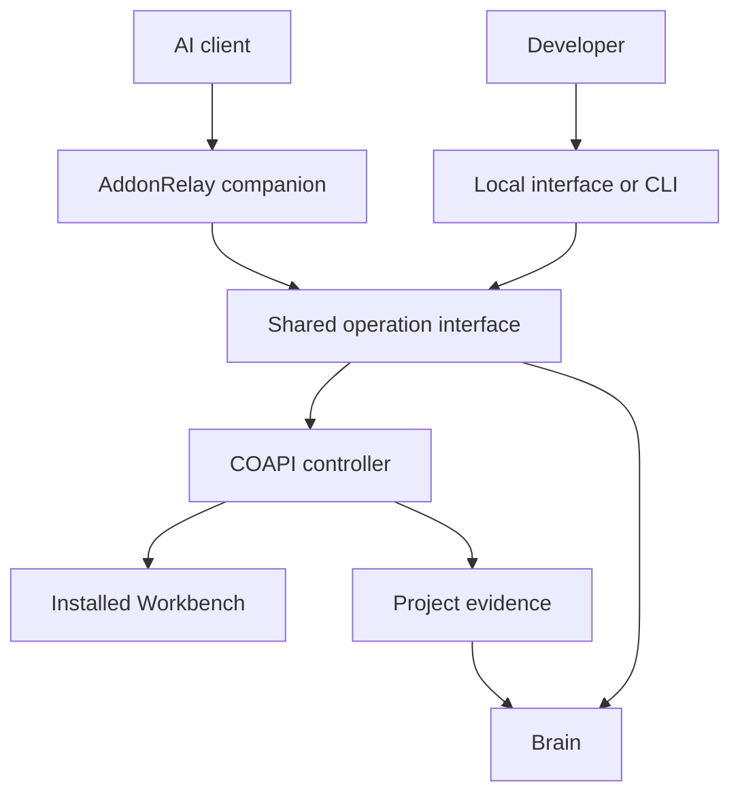

# AddonRelay architecture

AddonRelay is the product developers connect to. The planned COAPI Framework adapter supplies controlled execution, evidence and recovery. Brain is the planned layer for persistent project memory and reviewed diagnostic knowledge.

This document describes the **target public architecture**. The existing companion exposes six local read-only tools: `find_symbol`, `resolve_resource`, `guidance`, `diagnose_log`, `check_server_config` and `compare_addons`. Native Workbench execution, durable recovery of native operations and the public Brain integration are planned capabilities. See [Capabilities](CAPABILITIES.md) for the availability boundary and [Start here](START_HERE.md) for the current usable path.

## One engine for agents and developers

An AI agent and an experienced developer should be able to run the same supported check and inspect the same result. The interface may differ; the underlying operation, permissions and evidence must agree.

The shared operation interface is a proposed adapter over existing execution concepts. It should not create another scheduler, duplicate operation history or independent authorization system. The website distributes the product, explains supported configurations and provides documentation. Local development must not depend on a browser account or a permanently available website.

The current public repository contains a historical sanitized backend subset. Its presence does not establish that the complete architecture is packaged for external projects. The [roadmap](ROADMAP.md) defines the work and observations needed to reach that point.

## Explicit project selection

The planned adapter binds every operation to a selected workspace. That binding identifies the project root and `.gproj`, installed tools, read-only provider locations, state directories and permitted outputs. It must distinguish portable project settings from machine-specific paths and credentials.

Project selection is deliberate. When a directory contains multiple projects, the interface should display them and require a clear selection. A running editor window is not sufficient evidence that the intended source is loaded. Before native work, the adapter checks the selected project and the actual installed tool identities.

Each project owns its journal, receipts and memory. A result from project A cannot satisfy a check for project B merely because their files or errors have similar names. Workstation resources remain shared: separate projects may compete for the same Workbench process, memory, ports and CPU. Native admission therefore needs a workstation-level lease as well as project-level state.

The generic adapter must work on an unrelated addon without the Conflict Operations campaign, provider stack, credentials or release history. Existing project-specific workflows can retain their original settings through a compatibility adapter.

## Named operations instead of arbitrary commands

The public operation interface should accept a reviewed recipe and typed parameters. Examples of intended recipes are project inspection, a supported compile configuration, a bounded resource probe and private startup of an owned sample. These are proposed operation classes, not currently installed command names.

Each recipe declares its inputs, allowed outputs, relevant identities, required permissions, deadline, resource needs, expected observation and recovery behavior. The controller constructs the native command. Retrieved text, a model response or a project file cannot supply an unrestricted shell command or authorize itself.

The planned interface covers preparation, start, status, reconciliation and cancellation. A human CLI should call the same implementation as the companion. Readable summaries and structured output must describe the same underlying result. See [Developer guidance](DEVELOPERS.md) for the intended extension boundary and [Agent guidance](AGENT_GUIDE.md) for current connection use.

Preparation gathers inexpensive prerequisites together. Missing tools, unsupported versions, provider gaps, conflicting work and insufficient headroom should produce an actionable result before a costly launch. Dispatch rechecks facts that can change, including source identity, authorization, deadline and process ownership.

## Operations survive the conversation

A native operation must have durable state independent of one agent message or connection. The caller receives an operation handle and can inspect progress without resubmitting the work. Repeating the same start request returns or reconciles that operation; a deliberate new run requires its own declared identity and reason.

The controller records intent before launch, tracks the owned process and seals the resulting evidence. Recovery examines the journal, process identity and receipts before choosing the next action. A stopped process alone does not prove that a compile completed or an external action succeeded.

Cancellation is also an operation with an observed outcome. A request to cancel must not immediately be displayed as a confirmed stop. It targets only owned work. Each recipe states whether losing the client connection leaves admitted work running under its controller or requests a stop. Both behavior and recovery require testing.

Public states should distinguish preparation, rejection before launch, running work, completion, failure, cancellation requested, cancellation confirmed and an uncertain outcome. A new display vocabulary must not rewrite historical receipts or turn an incomplete observation into success.

## Evidence describes what was established

Every native result should retain three separate dimensions:

| Dimension | Question answered |
|---|---|
| Execution outcome | Did the admitted process run and reach its declared terminal state? |
| Observation validity | Did the fixture and collection produce the required, correctly bound evidence? |
| Behavior established | What specific claim does that evidence support? |

A successful compile establishes compilation for its recorded inputs. It does not establish appearance, multiplayer replication, controller behavior or performance. Current local diagnostic reports retain their `engine-not-tested` meaning. Native evidence needs its own scoped envelope rather than changing that existing meaning.

Receipts should identify the selected project, source and provider inputs, tool version, recipe implementation, observation and retained evidence. Reuse depends on the inputs relevant to the claim. A documentation edit should not invalidate an unrelated compile result, while a changed source or evaluator may require a focused rerun.

Full logs remain in bounded local evidence storage. Interfaces return decisive excerpts and references, with an explicit way to inspect more. Reporting failure must not erase a completed engineering result.

## Local connection and permissions

The current companion uses local stdio. The planned native interface should preserve that simple connection path for supported local clients. A cloud-only chat service cannot start a process on a developer's workstation without an appropriate connection mechanism. Compatibility must be demonstrated for actual client versions and configurations, as described in [Compatibility](COMPATIBILITY.md).

Developers should be able to grant a continuing local-development scope for a selected workspace. Ordinary actions within that scope should not require repeated approval prompts. Publication, production deployment, paid work and sharing have separate boundaries. The tool still validates the scope and current facts before dispatch.

Manual Workbench use remains supported. The adapter must not take over an unowned session, discard unsaved changes or assume the editor's in-memory state matches files on disk. Ask for saving only when the selected operation depends on those bytes, and record the source actually used.

## Distribution and data boundaries

The initial native target is Arma Reforger Workbench on Windows. Other Enfusion applications, platforms and engine versions need their own support decision and acceptance. Users obtain the game, Workbench and providers through their authorized installations; those assets are not part of the planned framework distribution.

A release manifest should bind the product components, selected recipes, runtime dependencies, memory schema and compatibility record. Updates preserve project evidence and memory, with explicit migrations and recoverable failures. Uninstalling the tool should not silently delete a developer's project history.

Project memory, team sharing and reviewed references have separate scopes, explained in [Brain](BRAIN.md). Local checks can avoid uploading files while still returning selected results to an AI client whose provider processes them remotely. [Privacy](PRIVACY.md) explains those distinct paths.

Free local use and optional prepaid hosted work remain separate product tracks. See [Commercial direction](COMMERCIAL.md). This architecture document does not activate a hosted service or grant software rights; the repository's [notice](../../NOTICE.md) remains applicable.

## Native reference

Bohemia documents [Workbench plugins](https://community.bohemia.net/wiki/Arma_Reforger%3AWorkbench_Plugin?useskin=vector), including editor-specific modules and command-line invocation. The public adapter should use installed definitions and the supported interfaces for its qualified engine version. That extension mechanism is a foundation for recipes, not proof that a particular AddonRelay recipe has passed.
